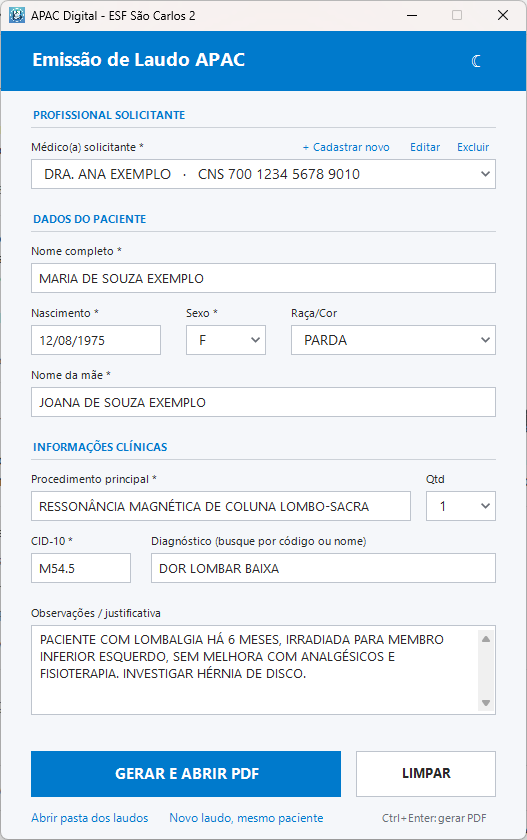
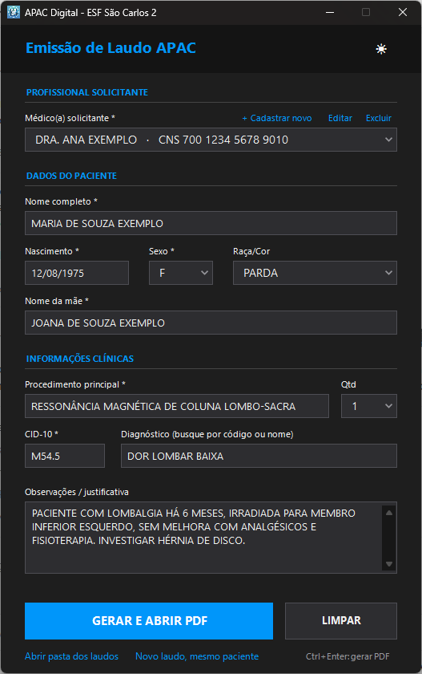
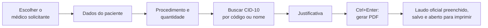
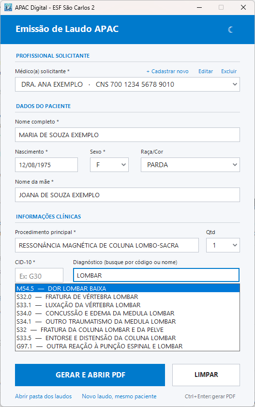
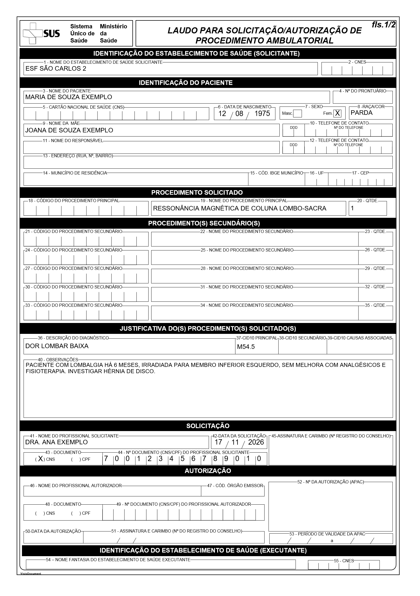
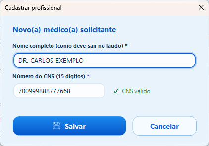

# APAC Digital

**Aplicativo para Windows que preenche e gera o Laudo de APAC do SUS em PDF em menos de um minuto, pronto para imprimir.**

Criado na prática da Estratégia Saúde da Família (ESF São Carlos 2) para tirar do dia a dia do consultório o preenchimento manual e repetitivo do *Laudo para Solicitação/Autorização de Procedimento Ambulatorial* (APAC), que é exigido para pedir exames e procedimentos de média e alta complexidade.

[](https://github.com/adalbertozauli/APAC_digital/releases/latest)


<p align="center">
  
  &nbsp;&nbsp;
  
</p>

> Todas as imagens usam dados fictícios.

---

## O problema

O laudo de APAC é um formulário em papel com dezenas de campos. Na rotina da unidade, ele costuma ser preenchido à mão, várias vezes ao dia e quase sempre com os mesmos dados do profissional e da unidade. Isso consome tempo de consulta, gera letra ilegível, erros e falta de CID, e faz laudos voltarem da regulação.

## A solução

O APAC Digital reúne só os campos que o médico realmente precisa digitar numa tela simples, encontra o CID-10 pelo nome da doença e gera o laudo oficial já preenchido, em PDF, com a data do dia e os dados do profissional.

| Antes | Com o APAC Digital |
| --- | --- |
| Preencher o formulário à mão | Digitar só os dados do paciente e do pedido |
| Procurar o CID-10 numa tabela | Buscar pelo código ou pelo nome (ex.: "lombar") |
| Reescrever nome e CNS do médico em todo laudo | Escolher o profissional uma vez; o app lembra |
| Letra difícil de ler e campos esquecidos | Texto digitado e aviso de campos obrigatórios em branco |
| Papel avulso | PDF salvo e organizado por paciente, data e hora |

---

## Como funciona



### 1. Busca de CID-10 pelo nome ou pelo código

Ao digitar no campo **Diagnóstico**, o app sugere os CIDs na hora, mesmo sem acento e com o termo no meio do nome. O código também pode ser digitado com ou sem ponto (`M545` ou `M54.5`). Ao escolher uma sugestão, o CID e a descrição são preenchidos juntos.

<p align="center">
  
</p>

A base tem **14.512 códigos**: a tabela CID-10 oficial do DATASUS e os códigos incluídos depois de 2008 que constam na tabela do SIGTAP (por exemplo Zika, estádios da doença renal crônica e condições pós-COVID-19).

### 2. O laudo oficial, preenchido

O app preenche o próprio modelo do laudo do Ministério da Saúde, com nome da unidade, paciente, data de nascimento, sexo, raça/cor, nome da mãe, procedimento, CID-10, justificativa, profissional solicitante (nome e CNS) e data da solicitação. Textos longos têm a fonte reduzida automaticamente para caber no campo. Se mesmo assim não couberem, o app avisa antes de você imprimir.

<p align="center">
  
</p>

### 3. Pensado para a rotina do consultório

- **Cadastro de profissionais:** cada médico(a) é cadastrado uma vez, com nome e CNS. O CNS é conferido pelo dígito verificador oficial, e o último profissional escolhido é lembrado.
- **Vários pedidos para o mesmo paciente:** "Novo laudo, mesmo paciente" (`Ctrl+N`) mantém o paciente e limpa só o procedimento, o CID e a justificativa.
- **Feito para usar pelo teclado:** `Enter` passa para o próximo campo e `Ctrl+Enter` gera o PDF.
- **Validação sem travar:** campos obrigatórios em branco são destacados, e o app pergunta antes de gerar em vez de bloquear.
- **Organização dos arquivos:** os laudos ficam numa pasta escolhida na instalação (padrão: `Documentos\APAC Digital\Laudos`), com nome e horário no arquivo, por exemplo `Laudo_MARIA_DE_SOUZA_2026-11-17_143005.pdf`. Essa pasta não é apagada ao desinstalar.
- **Tema claro e escuro,** que segue o tema do Windows ou a escolha do usuário.
- **Funciona sem internet:** nenhum dado de paciente sai do computador.

<p align="center">
  
</p>

---

## Instalação

1. Baixe o **`APACDigitalSetup.exe`** em [Releases](https://github.com/adalbertozauli/APAC_digital/releases/latest).
2. Execute-o. O instalador pergunta onde salvar os laudos e cria atalhos na área de trabalho e no menu Iniciar.
3. Pronto. Não é preciso instalar o .NET nem permissão de administrador.

Para desinstalar, use **Configurações → Aplicativos instalados → APAC Digital**.

> O Windows pode mostrar o aviso do SmartScreen porque o instalador não é assinado digitalmente. Clique em **Mais informações → Executar assim mesmo**.

---

## Tecnologia

| | |
| --- | --- |
| Linguagem e interface | C# com Windows Forms (.NET 10), executável autocontido |
| PDF | [iText 8](https://itextpdf.com/), que preenche o formulário oficial (AcroForm) |
| Dados | Tabela CID-10 do DATASUS e do SIGTAP; cadastro local em JSON |
| Qualidade | Testes automáticos de geração do PDF, cadastro e tela |
| Distribuição | GitHub Actions compila, testa e publica o instalador a cada versão |

### Estrutura do código

```text
Program.cs                    Tela principal (formulário, busca de CID, temas, atalhos)
FormProfissional.cs           Cadastro e edição de profissionais
Models/DadosApac.cs           Dados de um laudo
Models/Profissional.cs        Profissional, validação de CNS e repositório local
Services/GeradorPdfService.cs Preenchimento do PDF com iText
Templates/                    Modelo oficial do laudo (PDF preenchível)
cids.txt                      Tabela CID-10 (DATASUS + SIGTAP)
installer/Setup/              Instalador próprio (.exe)
scripts/                      Publicação e geração do instalador
tests/APACDigital.Tests/      Testes automáticos
```

<details>
<summary><strong>Para desenvolvedores: compilar, testar e publicar</strong></summary>

### Requisitos

- Windows x64
- [.NET SDK 10](https://dotnet.microsoft.com/download)

### Executar

```powershell
dotnet run --project .\apac_biblioteca.csproj
```

### Testes

```powershell
dotnet run --project .\tests\APACDigital.Tests
```

Termina com `TODOS OK`. O GitHub Actions roda os mesmos testes a cada envio. Para gerar as capturas de tela e o laudo de exemplo usados neste README (somente dados fictícios):

```powershell
dotnet run --project .\tests\APACDigital.Tests -- telas
```

### Vídeo de demonstração

Grava o app sendo preenchido com dados fictícios, monta as cenas em 1920 × 1080 (requer Python com Pillow) e codifica o MP4 com o codificador do próprio Windows:

```powershell
dotnet run --project .\tests\APACDigital.Tests -- video
$v = ".\tests\APACDigital.Tests\bin\Debug\net10.0-windows10.0.19041.0\win-x64\saida-testes\video"
python .\scripts\montar-video.py $v
dotnet run --project .\tests\APACDigital.Tests -- codificar "$v\cenas" .\docs\video\apac-digital-demo.mp4
```

A janela do app aparece na tela durante a gravação (cerca de 1 minuto). A pasta `docs\video` não vai para o Git.

### Gerar o instalador

```powershell
.\scripts\build-installer.ps1 -Version 1.2.0
```

O instalador é gravado em `Instalador\install.exe`. Se o Windows bloquear scripts, rode:
`powershell.exe -NoProfile -ExecutionPolicy Bypass -File .\scripts\build-installer.ps1`.

### Publicar uma versão

```powershell
git tag v1.2.0
git push origin v1.2.0
```

O GitHub Actions gera o `APACDigitalSetup.exe` e o anexa em **Releases**.

### Dados locais

| O quê | Onde |
| --- | --- |
| Programa | `%LOCALAPPDATA%\APACDigital` |
| Profissionais cadastrados | `%APPDATA%\APAC Digital\profissionais.json` |
| Preferências (tema, último profissional, pasta dos laudos) | `%APPDATA%\APAC Digital\preferencias.txt` |
| Laudos | Pasta escolhida na instalação (padrão `Documentos\APAC Digital\Laudos`) |

### Tabela CID-10

`cids.txt` (UTF-8, formato `CODIGO,DESCRICAO`) foi convertido de `CID10CSV.zip` do DATASUS (http://www2.datasus.gov.br/cid10/V2008/) e completado com os códigos posteriores a 2008 do `tb_cid.txt` da Tabela Unificada do SIGTAP (competência 11/2026). No SUS, a COVID-19 é codificada como B34.2, porque o SIGTAP não traz U07.1/U07.2.

</details>

---

## Licença e aviso

O projeto usa o iText, distribuído sob a licença AGPL (com opção comercial). Antes de redistribuir, confira se o uso pretendido está de acordo com essa licença.

O APAC Digital é uma ferramenta de apoio ao preenchimento. A responsabilidade pelo conteúdo clínico do laudo continua sendo do profissional solicitante.
